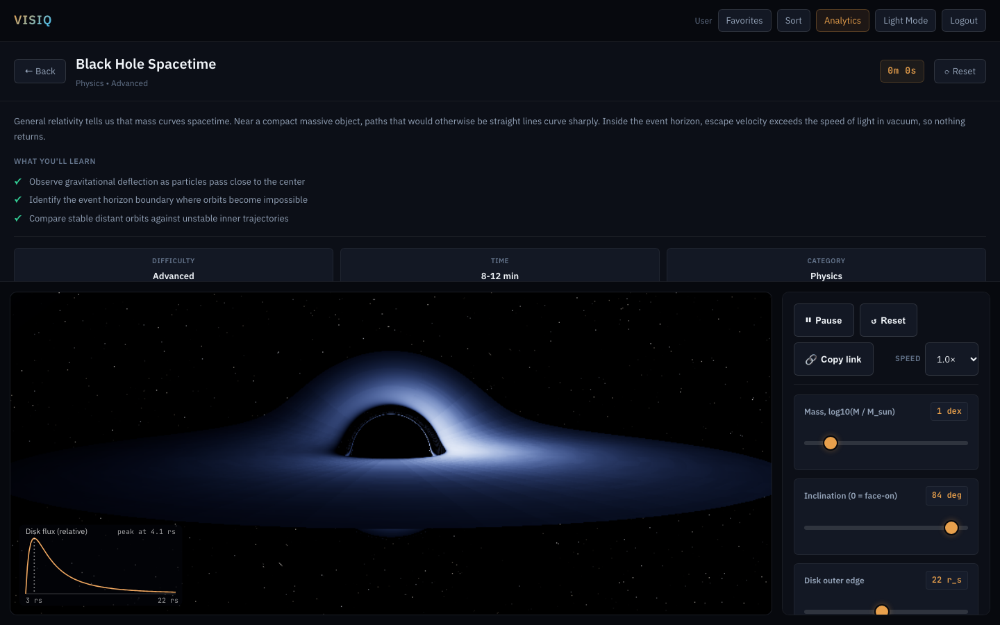

# VISIQ

VISIQ is a free, interactive science simulation site for curious people aged 15 to 80. It is a static site built with vanilla JavaScript and CSS - no framework, no bundler, no backend. Every simulation is a real model you can touch, not a canned animation.



Live site: https://toibawani.github.io/Visiq/

## What is here

VISIQ is a gallery of science simulations. Each one runs in the browser and responds to pointer, keyboard, and on-screen controls in real time. The catalog lives in `assets/simulations-data.js`, which is the single source of truth: the gallery renders every entry from it, and any count you see on the live site is computed from that array at load time (not hand-typed).

The site splits into physics, biology, geography, and astronomy. Three simulations have been rebuilt as 3D heroes with measured, published numbers: a ray-marched black hole, a true-scale solar system, and an Earth-and-seasons model. The rest are 2D p5.js sketches in instance mode.

## Technically interesting things

- **Physics validated by known-answer tests.** The solar system integrator is checked against NASA/JPL orbital elements (Kepler's third law, perihelion, Earth's year, Mercury's speed), the black hole against the Schwarzschild photon sphere and ISCO, and the seasons model against declination and day length at real dates. See `tests/solar-system.test.js`, `tests/relativity.test.js`, `tests/seasons.test.js`.
- **GPU ray-marched black hole.** The black hole simulation renders gravitational lensing in a fragment shader, with Doppler beaming, gravitational redshift, and a visible photon ring. The shadow radius was measured against the predicted value (59 px vs 56.9 px predicted). See `sketches/black-hole.js` and `evidence/black-hole/VERIFICATION.md`.
- **Fixed-timestep integrators.** A shared integrator layer (`assets/integrators.js`) exposes Euler, semi-implicit Euler, Verlet, and RK4, used by the double pendulum and black-hole orbit sketches, with live energy-drift graphs.
- **Leak-tested 3D lifecycle.** Every 3D hero passes a 20 open-close cycle test with identical geometry, texture, and program counts, and a flat JS heap. See `assets/sim-base.js` and `evidence/*/leak-*.json`.


## Run locally

The site is fully static. Serve the folder with any web server:

```
git clone https://github.com/toibawani/Visiq.git
cd Visiq
python3 -m http.server 8000
```

Then open http://localhost:8000. The service worker does not register on localhost, so you always get fresh files.

## Run tests

```
npm install
npm test
```

Vitest runs 73 tests across 7 files (integrators, orbit drift, relativity, seasons, solar system, persistence, font glyph coverage). The suite takes about one second. CI runs the same command on every push.

## Measured numbers

Every figure below comes from a file in `evidence/` that you can reproduce yourself. None are hand-typed estimates.

| Figure | Where it comes from | Reproduce with |
|--------|---------------------|----------------|
| 73 tests pass, 1.09s | `npm test` output | `npm test` |
| Solar system at 60 fps, unthrottled and 4x CPU throttle | `evidence/solar-system/fps-unthrottled.json`, `fps-4x-throttle.json` | `scripts/verify-3d.mjs fps solar-system 6` |
| Solar system: 20 open-close cycles, zero retained geometries/textures/programs | `evidence/solar-system/leak-20-cycles.json` | `scripts/verify-3d.mjs leak solar-system 20` |
| Black hole shadow radius 59 px vs 56.9 px predicted | `evidence/black-hole/VERIFICATION.md` | view live capture in `evidence/black-hole/` |
| Black hole: 20-cycle leak flat, heap unchanged | `evidence/black-hole/leak.json` | `scripts/verify-3d.mjs leak black-hole 20` |
| 13 planet textures, 1,091 KB total webp | `assets/textures/planets/PROVENANCE.json` | `scripts/fetch-planet-maps.mjs` |
| Solar system scene: 9,794 triangles, 15 draw calls | `evidence/solar-system/VERIFICATION.md` | open `evidence/solar-system/sheets/` |

Scores quoted in this README only appear because they live in `evidence/` with a reproducing command.

## Project structure

```
index.html            Landing and gallery shell
gallery.js            Renders the simulation grid, search, filters, sorting
style.css             Design system (Fraunces, IBM Plex Sans, JetBrains Mono)
assets/
  simulations-data.js  Catalog: single source of truth, read at load time
  sim-base.js          Sim mount/destroy lifecycle, URL params, teardown
  integrators.js       Euler, semi-implicit Euler, Verlet, RK4
  visual-kit.js        Shared canvas drawing helpers
  vendor/three/        Vendored three.js 0.186.1 (MIT, pinned)
sketches/              One p5.js instance-mode sketch per simulation
tests/                 Vitest specs
scripts/               Dev tooling (thumbnail capture, planet-map fetch, font subsetter)
evidence/              Raw measurement files for every published number
docs/                  Architecture, decisions, sources, physics, walkthrough
```

## What this doesn't do

- It is not a backend product. There is no database, no cloud saving, no leaderboards, and no shared content. Nothing you do in a simulation leaves your device.
- It does not guarantee scientific precision for real-world design. Each simulation states its own limits in a "what this model leaves out" line.
- It does not log you, track you, or fingerprint you. The only third-party request is p5.js from cdnjs.
- It is not a replacement for a telescope or a lab. It is a playground for curiosity.

## What I'd build next

- Galaxy collision with Barnes-Hut in a web worker (20,000+ stars, dark-matter halo, tidal tails).
- Hydrogen orbitals from the real wavefunctions (n, l, m), tested against analytical expectation values.
- An FFT ocean from a Phillips spectrum, plus a two-source ripple tank.
- Charged particles in magnetic and electric fields with a Boris integrator.

These are in the backlog, not this build. Two excellent simulations beat four rushed ones.

## Stack

- Vanilla JavaScript, HTML, CSS (no framework, no bundler)
- p5.js (instance mode, 2D sketches)
- three.js 0.186.1 (vendored, 3D heroes)
- Vitest (tests)
- Self-hosted fonts: Fraunces, IBM Plex Sans, JetBrains Mono

## License

MIT - see `LICENSE`.