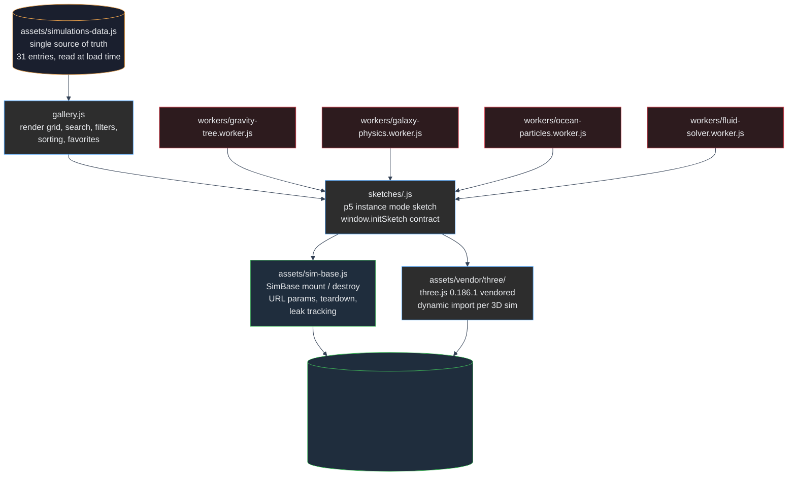

# VISIQ Architecture

One Mermaid diagram covers the whole stack: the catalog source of truth, the
SimBase mount/destroy lifecycle, script and three.js loaders, 3D boot, and the
web workers.

## How the pieces connect

- **Catalog.** `assets/simulations-data.js` is a classic script that attaches
  `window.SIMULATIONS`. The gallery reads it at load time and renders one card
  per entry. Any count on the site comes from this array, never hand-typed.
- **SimBase lifecycle.** Each sketch returns an object with `destroy()` from
  `window.initSketch(...)`. `SimBase.destroy()` disconnects observers, clears
  timers, removes the p5 instance, and wipes the canvas and controls containers.
  The 20 open-close leak test exercises this path.
- **Loaders.** p5.js arrives from cdnjs via a script tag in `index.html`.
  three.js is vendored at `assets/vendor/three/` and fetched by dynamic
  `import()` only inside a 3D sketch, so the gallery never pays its 417 KB
  gzip cost.
- **3D boot.** A 3D sketch imports three.js, builds a scene/canvas, runs one
  WebGL2 context per page, and falls back to a plain note if WebGL2 is missing.
- **Workers.** Gravity tree, galaxy collision, ocean particles, and fluid
  solver each run in a dedicated worker, keeping the main thread free for
  rendering and interaction.

